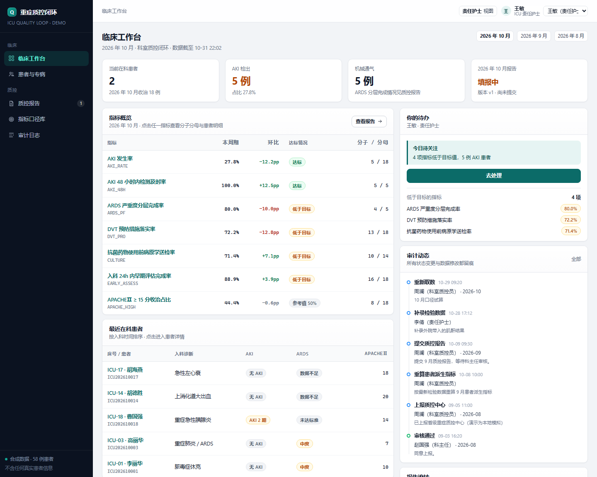

# 重症质控闭环工作台（简化演示版）

一个可以在本机跑起来的小系统：**护士录数据 → 规则引擎出结论 → 质控员填报 → 科主任审核 → 上报并冻结口径**，
中间每一步都能点开看到「这个数字是怎么来的」。另外带一个会调用工具、但**不允许自己改数据**的临床 Agent。



> 全部患者、检验、事件均为合成数据（58 例、4007 条检验、225 条护理事件），不含任何真实医疗信息。
> 参考了《重症监护信息管理系统 软件架构文档 V7.0》的能力划分（质控、专病规则、护理事件、多角色），
> 但**没有复刻**其微服务架构与实现，规模按 3 天可交付的演示版重新裁剪。

---

## 1. 为什么是这三个能力

应聘的岗位看重三件事，这个作品就只把这三件事做深，其余全部砍掉：

| 岗位要求 | 作品里的对应实现 | 可以现场验证的地方 |
| --- | --- | --- |
| 多角色、多环节审批，状态流转 | 报告状态机 `draft → submitted → approved → reported`，退回 `returned` 版本号 +1 | 切换 5 个身份，走一遍退回再审 |
| 填报 / 统计口径，结果可追溯 | 7 项指标，每项 = 一段可读 SQL + 人话公式 + 目标值；分子分母可下钻到患者与原始事件 | 「指标口径库」看 SQL，「质控报告」点下钻 |
| AI 应用与 Agent 设计（不只是用 AI 写代码） | 8 个工具 + 确定性规划器 + 可选大模型 function calling + 写操作人工确认 | 患者页右侧「临床 Agent」，展开工具轨迹 |

---

## 2. 快速开始

要求 **Node.js ≥ 22.5**（项目使用内置 `node:sqlite`，无需 Docker / 数据库服务）。

```bash
pnpm install          # 或 npm install
pnpm seed             # 生成合成数据 + 3 个质控周期 + 报告初始状态
pnpm dev              # http://localhost:3310
```

其他命令：

```bash
pnpm test             # 12 个用例：规则引擎 + 指标口径 + 报告流转
pnpm typecheck        # tsc --noEmit
pnpm reset            # 清库重灌
```

---

## 3. 五个身份，一条完整故事

右上角下拉框可随时切换身份（演示版用 cookie 记录，真实系统应接 SSO）。

| 身份 | 能做什么 | 演示要点 |
| --- | --- | --- |
| 王敏 · 责任护士 | 看患者、看缺口、问 Agent | 打开 ICU-01，看 KDIGO 判据与 DVT 缺口 |
| 周澜 · 科室质控员 | 提交报告、按当前口径重取数、采纳 AI 草稿 | 10 月报告：先看校验拦住了什么，再补说明提交 |
| 赵国强 · 科主任 | 审核通过 / 退回修订 / 上报质控中心 | 退回时写原因，版本号 +1，再让质控员重提 |
| 陈立 · 主管医生 | 看专病结论、问 Agent | 问「他的氧合符合 ARDS 吗」 |

**推荐走位（3 分钟）**：见 [`docs/演示脚本.md`](docs/演示脚本.md)。

---

## 4. 架构：四层，每层只做一件事

```
原始数据层            observations（检验/尿量/血气）  care_events（评估/送检/抗菌药/DVT/上机）
   │                  ← 真实系统里由 LIS、护理记录、设备网关写入
   ▼
派生层 patient_metrics  lib/features.ts + lib/engine.ts
   │                  KDIGO 分期、柏林分度、24h 评估、用药前送检……
   │                  每个患者一行，evidence 字段保存全部判据与原始取值
   ▼
口径层 indicator_defs   7 条 SQL，按 period 参数在患者粒度产出 (eligible, hit)
   │                  分子 = Σhit，分母 = Σeligible，永远可以下钻复现
   ▼
报告层 qc_reports       状态机 + 提交时冻结快照（snapshot）+ audit_logs 全量留痕
```

这样切分的原因：**规则会变，口径也会变，但两者不该互相牵连**。
KDIGO 阈值调整只动 `engine.ts`；质控口径调整只动一条 SQL；报告模板不用动。

关键文件：

```
lib/engine.ts        纯函数规则引擎（可单测、无 IO）
lib/features.ts      原始数据 → 患者级派生特征
lib/indicators.ts    指标口径（SQL 即文档）
lib/reports.ts       状态机、校验、冻结快照、下钻
lib/agent.ts         工具定义 + 规划器 + LLM function calling + 轨迹
lib/rebuild.ts       唯一允许重算派生层的入口
db/schema.sql        10 张表，全部带注释
scripts/seed.ts      确定性随机（固定种子），每次生成同一份数据
```

---

## 5. 数据模型（10 张表）

| 表 | 作用 | 关键设计 |
| --- | --- | --- |
| `users` | 5 个角色 | nurse / doctor / qc / director |
| `patients` | 患者与入出科 | `mrn` 唯一，`status` 区分在科/已出科 |
| `observations` | 检验与床旁数据 | `(patient_id, code, measured_at)` 建索引 |
| `care_events` | 护理事件与医嘱执行 | 指标里的「时间点」全来自这里 |
| `patient_metrics` | 派生层 | `evidence` 存判据 JSON，可回放 |
| `indicator_defs` | 口径定义 | SQL 存库，界面直接展示，改口径不用改代码 |
| `indicator_results` | 周期指标结果 | `(period, code)` 唯一，重取数是幂等覆盖 |
| `qc_reports` | 报告与快照 | `snapshot` 冻结分子分母与患者 ID 列表 |
| `audit_logs` | 审计 | 保留 `before_json` / `after_json` |
| `agent_runs` | Agent 轨迹 | 每次会诊的步骤 JSON 落库，可复盘 |

---

## 6. 规则引擎：可解释优先

`lib/engine.ts` 是纯函数，输入原始序列，输出**结论 + 判据表**。

- **AKI（KDIGO 2012）**：肌酐倍率（1.5 / 2.0 / 3.0×）、48h 内绝对升高 ≥ 0.3 mg/dL、尿量窗口（6h / 12h / 24h 平均 < 0.5 / 0.3 mL/kg/h）、RRT。
  取所有命中判据里的最高分期；尿量窗口按小时聚合后计算平均值。
- **ARDS（柏林定义）**：P/F ≤ 300 且 PEEP ≥ 5；分度 200 / 100。
  **PaO₂、FiO₂、PEEP 任一缺失时返回 `insufficient`，不猜分级**——这是刻意的：宁可标记数据不足，也不给一个看起来合理的假结论。

界面上每条判据都显示「实测值 / 阈值 / 是否命中」，未命中的也展示（默认折叠）。
这就是面试时可以说的一句话：**结论可以被质疑到具体某一行数字**。

---

## 7. 指标口径（7 项）

| 编码 | 指标 | 公式 | 方向 |
| --- | --- | --- | --- |
| `AKI_RATE` | AKI 发生率 | AKI 患者 ÷ 收治患者 | 越低越好（≤35%） |
| `AKI_48H` | AKI 48h 内检测及时率 | 48h 内有肌酐的 AKI ÷ AKI 患者 | ≥90% |
| `ARDS_PF` | ARDS 严重度分层完成率 | 有 P/F 的机械通气患者 ÷ 机械通气患者 | ≥85% |
| `DVT_PRO` | DVT 预防落实率 | 24h 内落实预防 ÷ 收治患者 | ≥90% |
| `CULTURE` | 用药前病原学送检率 | 送检早于首剂 ÷ 使用抗菌药患者 | ≥80% |
| `EARLY_ASSESS` | 24h 内早期评估完成率 | 24h 内评估 ÷ 收治患者 | ≥95% |
| `APACHE_HIGH` | APACHEⅡ ≥15 收治占比 | ≥15 分患者 ÷ 收治患者 | 参考值（不设达标线） |

两个容易被追问的定义，已经写进 `rationale` 字段并显示在界面上：

- `CULTURE` 的「用药前」= 送检事件时间 ≤ 首次抗菌药给药时间，同一患者多次用药取首次。
- `AKI_48H` 的分母只含 AKI 患者，避免把「没得 AKI」的人算成「没及时检测」。

---

## 8. Agent 设计

**工具（8 个）**：`get_patient`、`calc_aki`、`calc_ards`、`list_observations`、`indicator_board`、`list_gaps`、`explain_indicator`、`draft_report_note`、`audit_trail`。

三条硬约束：

1. **模型不能直接查库**。所有数据必须经过工具，工具返回结构化结果 + 一句人话观测值；
2. **每次调用都留痕**。前端把 `tool / args / observation` 摊开，`agent_runs` 落库，事后可复盘；
3. **写操作必须人工确认**。Agent 只生成「报告说明草稿」，点「采纳」才写入，审计里记录 `agent_draft_adopted`。

两种引擎，同一套轨迹结构：

- 未配置模型 Key：**确定性规划器**（意图 → 工具序列），保证演示不依赖外网，也不会瞎编；
- 配置 `LLM_API_KEY`（OpenAI 兼容接口）：走 function calling 多轮工具循环，失败自动降级到规划器。

```bash
# 可选：接入真实模型
LLM_API_KEY=sk-xxx LLM_BASE_URL=https://api.deepseek.com/v1 LLM_MODEL=deepseek-chat pnpm dev
```

示例对话（离线规划器，3 次工具调用）：

> **问**：为什么 DVT 预防率环比下降？
> **答**：DVT 预防措施落实率：85.0% → 72.2%（下降 12.8 个百分点），分母 18 例。
> 未命中原因逐条核对：李丽华（ICU-01）— DVT 预防事件晚于 24h 或缺失；……

---

## 9. 测试

```bash
pnpm test
```

- `tests/engine.test.ts`：9 个用例覆盖 AKI 各分期、尿量窗口、数据不足、ARDS 分度与 PEEP 前提；
- `tests/flow.test.ts`：3 个用例覆盖指标分子分母自洽、退回后版本号递增、提交校验阻断。

测试跑在种子库的临时副本上（`data/_test.db`），不会污染演示数据。

---

## 10. 明确的边界（没有做的事）

诚实列出来，避免被当成"没做完"：

- **没有真实系统对接**：LIS / 设备网关 / 单点登录都是模拟的，接入口设计成 `observations` / `care_events` 两张表；
- **没有 DICOM / 影像**：影像不是这个岗位的核心，砍掉；
- **没有权限模型**：只有 4 个角色与界面级判断，没有 RBAC 表；
- **没有并发与性能优化**：单机 SQLite，演示规模 58 例患者；
- **没有前端组件库**：手写 CSS 设计系统（`app/globals.css`），为了可读与零依赖。

如果继续做，下一步优先级是：① 把口径 SQL 换成带版本的口径管理（改口径要留审批）；
② 报告导出 PDF；③ 把 `rebuild` 做成可回放的批处理任务。

---

## 11. 我在这份代码里做了什么

- 需求裁剪与数据模型设计、状态机与校验规则；
- 规则引擎（KDIGO / 柏林）与可解释判据结构；
- 指标口径 SQL、下钻、冻结快照与差异对比；
- Agent 工具契约、确定性规划器、LLM 接入与降级、HITL；
- 界面、种子数据、测试与文档。

AI 编程工具参与了实现（这正是岗位要求的能力），但**每一条规则、每一个口径、每一次状态流转都能被追问到具体代码行**，
这也是我把判据表、口径 SQL、审计轨迹都做进界面的原因。
